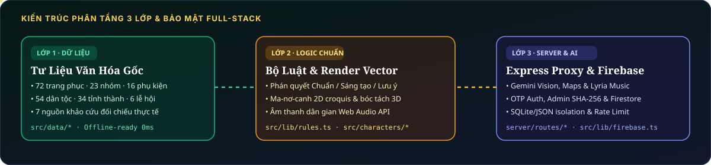

<div align="center">


<br />

[](https://react.dev/)
[](https://www.typescriptlang.org/)
[](https://vitejs.dev/)
[](https://tailwindcss.com/)
[](https://expressjs.com/)
[](https://firebase.google.com/)
[](https://ai.google.dev/)

<p>
  <strong>Trải nghiệm kể chuyện văn hóa, khảo cứu và phối thử trang phục truyền thống Việt Nam</strong><br />
  dẫn dắt bởi nhân vật <strong>Cò Em</strong> — tôn vinh di sản nếp áo <strong>54 dân tộc anh em</strong> trên dải đất hình chữ S.<br />
  <em>"Gìn giữ cốt cách xưa — Tự do thấu hiểu nay"</em>
</p>

</div>

---

## Đội ngũ phát triển (Team)

Dự án **Cò Em — Việt Phục Remix** được nghiên cứu, thiết kế và xây dựng bởi:

| Thành viên | Vai trò | Trọng trách chính |
| :--- | :--- | :--- |
| **Nguyễn Lê Bảo Đăng** | **Nhóm trưởng (Team Lead)** | Kiến trúc hệ thống Full-stack, điều phối luồng trải nghiệm end-to-end, bảo mật API & tích hợp AI / bản đồ / đồ họa 2D–3D |
| **Lê Diễm Quỳnh Như** | **Thành viên phát triển** | Nghiên cứu tư liệu khảo cứu Việt phục & 54 dân tộc, biên soạn nội dung lễ hội – chất liệu – câu hỏi văn hóa, thiết kế trải nghiệm & kiểm thử |

---

## 1. Tổng quan & Tính năng nổi bật

**Cò Em — Việt Phục Remix** kết hợp giữa **kho tư liệu văn hóa được đối chiếu nguồn**, **động cơ luật phối đồ minh bạch**, **đồ họa vector 2D/3D toán học** và **trợ lý AI bảo mật qua máy chủ**:

- **Bộ Sưu Tập Di Sản (`72 trang phục` · `23 nhóm văn hóa`)**: Tra cứu chi tiết từng bộ cổ phục (Giao Lĩnh, Viên Lĩnh, Đối Khâm, Áo Tấc, Nhật Bình, Áo Ngũ Thân, Áo Tứ Thân, Áo Dài...) và trang phục các dân tộc kèm lịch sử, chất liệu vải, nguồn khảo cứu.
- **Sắc Phục `54 Dân Tộc` & Sổ Thông Hành Triện Son**: Khám phá đầy đủ 54 dân tộc phân theo hệ ngôn ngữ, tự động đóng dấu sưu tầm **Con Dấu Triện Son** khi đọc hồ sơ trang phục hoặc chinh phục thử thách.
- **Bản Đồ Di Sản `34 Tỉnh Thành` (theo QĐ 19/2025/QĐ-TTg)**: Bản đồ SVG tương tác 4 vùng (Bắc Bộ, Trung Bộ, Tây Nguyên, Nam Bộ), tích hợp **Dòng Thời Gian** (`6 mốc lịch sử`) và **Sợi Chỉ Chung** (đối chiếu giao thoa giữa các nhóm văn hóa).
- **Xưởng Phối Đồ 2D Toán Học (`AvatarSVG` & `GarmentLayers`)**: Tùy chỉnh giới tính, độ tuổi, vóc dáng croquis 9 đầu, 6 tông da, kiểu tóc, góc nhìn trước/sau, phối màu và `16 phụ kiện` truyền thống lẫn hiện đại với chỉ báo chuẩn mực văn hóa theo thời gian thực.
- **Thử Đồ AI & Bóc Tách Di Sản 3D (`ThuDoAIScreen`)**:
  - Phân tích điểm khớp cơ thể qua Gemini Vision (`/api/try-on/transfer`) để căn chỉnh trang phục lên ảnh chân dung/bán thân.
  - Bóc tách cấu trúc lớp áo trực quan qua `DigitalHeritageInspectorModal`.
- **Lễ Hội & Gợi Ý Bối Cảnh Thời Tiết**:
  - `6 nhóm lễ hội lớn` trong năm kèm quy tắc mặc chuẩn văn hóa.
  - Gợi ý trang phục theo tiết trời thời gian thực từ **Open-Meteo** (hỗ trợ GPS theo yêu cầu, tìm kiếm thành phố, hoặc tọa độ đại diện vùng).
- **Đấu Trường Thám Tử Văn Hóa**: Gồm **`12 ca giám định 2D`** (bắt lỗi nón/khăn, phom áo, phụ kiện, họa tiết) và **`20 câu hỏi trắc nghiệm`** chia theo 4 chủ đề văn hóa kèm chuỗi combo.
- **Chợ Phiên, Làng Nghề & Gùi Ký Ức**: Đăng tải và bình chọn bản phối cộng đồng có lý do văn hóa, kết nối làng nghề đặt may / workshop di sản, lưu trữ bộ phối cá nhân vào **Gùi Ký Ức** và **Nhật Ký Trải Nghiệm**.
- **Trợ Lý Cò Em, Bản Đồ Địa Điểm & Nhạc Di Sản**: Chat hỏi đáp văn hóa có kiểm soát ngữ cảnh (`/api/gemini`), tìm bảo tàng/làng nghề bằng Google Maps Grounding (`/api/maps/heritage-places`), và tạo giai điệu dân tộc qua Lyria (`/api/music/generate`).
- **Xác Thực & Đồng Bộ Đám Mây**: Hỗ trợ **Email OTP 6 chữ số** (băm HMAC-SHA256), **Firebase Google Sign-In** (đổi sang Session Token máy chủ & đồng bộ Cloud Firestore), cùng **Cổng Quản Trị RBAC (`AdminScreen`)** xác thực qua biến môi trường bằng `timingSafeEqual` hoàn toàn trên máy chủ.

---

## 2. Kiến trúc hệ thống & Bảo mật



### Kiến trúc 3 lớp (3-Layer Cultural Integrity)

1. **Lớp 1 — Dữ liệu gốc kiểm chứng (`src/data/`)**:
   - Toàn bộ danh mục trang phục (`72`), nhóm văn hóa (`23`), 54 dân tộc, 6 lễ hội, 16 phụ kiện, 5 chất liệu vải, 6 mốc thời gian và 7 nguồn khảo cứu được nạp tĩnh tại client (`0ms` độ trễ, sẵn sàng ngoại tuyến).
2. **Lớp 2 — Bộ luật văn hóa xác định (`src/lib/rules.ts`)**:
   - Mọi phán quyết phối đồ (`Chuẩn mực`, `Sáng tạo`, `Cần xem lại`) được tính toán bằng quy tắc tường minh trong mã nguồn. AI **không** tự ý phán quyết đúng/sai văn hóa để loại bỏ thiên kiến và ảo giác dữ liệu.
3. **Lớp 3 — Server Proxy, Gemini AI & Cloud Sync (`server/` + `src/lib/firebase.ts`)**:
   - **Bảo vệ khóa API tuyệt đối**: `GEMINI_API_KEY` chỉ tồn tại trên Express server (`server/routes/aiRoutes.ts`), không bao giờ được nhúng vào bundle client.
   - **An toàn & Cô lập dữ liệu**: `server/security.ts` áp dụng HTTP security headers (`nosniff`, `SAMEORIGIN`, `Permissions-Policy`), rate limiting toàn cục (`180 req/phút`) & giới hạn riêng theo route nhạy cảm (`send-otp`, `verify-otp`, `admin-login`, AI routes), băm OTP bằng HMAC-SHA256, khử độc chuỗi chống XSS, và `redactSecrets` tẩy sạch khóa/đường dẫn khỏi log lỗi. Dữ liệu người dùng (Nhân vật, Bộ phối đồ, Đơn hàng) và Cộng đồng/Quản trị (Chợ Phiên, Làng Nghề, Workshop) được cô lập & lưu trữ trong SQLite (`node:sqlite` + fallback JSON nguyên tử tại `data_store/`) hoặc Cloud Firestore (`firestore.rules`).

### Các nhóm API máy chủ (`server.ts`)

| Nhóm Route | Endpoint tiêu biểu | Chức năng |
| :--- | :--- | :--- |
| **Auth** | `/api/auth/send-otp`, `/verify-otp`, `/firebase-session`, `/admin-login`, `/me`, `/logout` | Xác thực Email OTP 6 số (HMAC-SHA256), đổi Firebase ID Token sang Session Token 64-hex, xác thực Admin qua biến môi trường (`timingSafeEqual`) |
| **Storage & Sync** | `/api/health`, `/api/sync`, `/api/character`, `/api/outfits`, `/api/memories`, `/api/orders` | Đồng bộ đa chiều nhân vật & tủ đồ theo `user_id`, ký ức cộng đồng, đơn đặt may (yêu cầu đăng nhập) |
| **Community & Admin** | `/api/community/bootstrap`, `/posts`, `/village-orders`, `/workshop-registrations`, `/api/admin/*` | Lưu trữ Chợ Phiên, đặt may làng nghề, đăng ký workshop, che giấu PII & quản trị RBAC (`requireAdmin`) |
| **AI & Media** | `/api/try-on/transfer`, `/api/gemini`, `/api/maps/heritage-places`, `/api/music/generate` | Căn chỉnh điểm khớp thử đồ (tối đa 8MB), chat Cò Em có kiểm tra JSON Schema, Google Maps Grounding, Lyria Music |

---

## 3. Cấu trúc thư mục dự án

```text
co-em-viet-phuc-remix/
├── server.ts                  # Entrypoint Express Full-Stack (dev middleware + production static)
├── server/
│   ├── db.ts & dbTypes.ts     # Quản lý SQLite (node:sqlite) & JSON fallback cô lập theo userId
│   ├── dbCommunity.ts         # Lưu trữ SQLite cho Chợ Phiên, Làng Nghề, Workshop & cấu hình Admin
│   ├── emailService.ts        # Sinh mã OTP 6 chữ số bằng crypto & điều phối gửi email
│   ├── firebaseVerify.ts      # Xác thực Firebase ID Token phía server bằng chứng chỉ Google X.509
│   ├── security.ts            # Rate limiter đa tầng, HTTP headers, HMAC OTP, XSS sanitize, redactSecrets
│   └── routes/                # authRoutes.ts, storageRoutes.ts, communityRoutes.ts, aiRoutes.ts
├── src/
│   ├── App.tsx                # Shell giao diện trung tâm gọn nhẹ (Layout + Modals)
│   ├── app/                   # Điều phối trạng thái & routing (types.ts, useAppState.ts, ScreenRouter.tsx)
│   ├── characters/            # Hệ thống nhân vật croquis, tỉ lệ giải phẫu, tông da & layering
│   ├── components/            # UI module hóa (map 34 tỉnh, tham-tu, cho-phien, admin, thu-do-ai...)
│   ├── copy/                  # Từ điển giao diện tiếng Việt (coem.ts / domdom.ts)
│   ├── data/                  # Kho tư liệu văn hóa (trangphuc, dan_toc_54, le_hoi_di_san, tham_tu...)
│   ├── hooks/                 # Hooks đồng bộ trạng thái & thông báo (useAppSync.ts...)
│   ├── lib/                   # Bộ luật rules, âm thanh Web Audio API, Auth, Firebase, Gemini client
│   ├── narrator/              # Nhân vật dẫn chuyện Cò Em
│   ├── outfit/                # Logic & lớp vẽ trang phục 2D
│   └── screens/               # 19 màn hình chức năng tách module rõ ràng
├── public/                    # Tài nguyên tĩnh & SVG minh họa động
├── firestore.rules            # Quy tắc bảo mật Cloud Firestore
└── firebase-applet-config.json
```

---

## 4. Hướng dẫn cài đặt & khởi chạy

### Yêu cầu môi trường
- **Node.js** `>= 22.x` (hỗ trợ chạy trực tiếp TypeScript trên Node và `node:sqlite`)
- **npm** `>= 9.x`

### Cấu hình biến môi trường (`.env`)
Tham khảo tệp `.env.example` (tuyệt đối không commit khóa thật lên mã nguồn):
```env
GEMINI_API_KEY="YOUR_GEMINI_API_KEY"
APP_URL="http://localhost:3000"
# Bắt buộc nếu sử dụng cổng đăng nhập Quản trị viên (hoặc dùng ADMIN_PASSWORD_HASH):
ADMIN_PASSWORD="your-strong-admin-password"
```

### Các lệnh thực thi
```bash
# 1. Cài đặt các gói phụ thuộc (dùng --legacy-peer-deps với npm hoặc bun install)
npm install --legacy-peer-deps

# 2. Khởi chạy máy chủ phát triển Full-Stack (mặc định http://localhost:3000)
npm run dev

# 3. Kiểm tra kiểu dữ liệu TypeScript
npm run lint

# 4. Đóng gói frontend cho môi trường sản xuất (xuất ra thư mục dist/)
npm run build

# 5. Chạy máy chủ ở chế độ sản xuất
NODE_ENV=production npm start

# 6. Chạy bộ kiểm thử tự động phía server
npm test
```

---

## 5. Cách mở rộng dữ liệu văn hóa (Data-Driven)

Nhờ tách biệt hoàn toàn lớp dữ liệu và giao diện, việc bổ sung một nhóm văn hóa hoặc trang phục mới chỉ cần cập nhật tại `src/data/` mà **không cần sửa logic màn hình**:

1. **Thêm nhóm văn hóa** tại `src/data/nhom.ts` (`id`, `ten`, `vung`).
2. **Thêm trang phục** tại `src/data/trangphuc/` (`id`, `ten`, `nhomIds`, `gioiTinh`, `dip`, `thoiTiet`, `moTaNgan`, `suThat`, `mucRemix`, `nguonIds`, `daKiemChung`).
3. **Bổ sung phụ kiện / chất liệu / nguồn** (nếu có) vào `src/data/phukien.ts`, `src/data/vai.ts` và `src/data/nguon.ts`.

---

## 6. Nguồn tư liệu khảo cứu, Tài nguyên & Quyền riêng tư

### Nguồn tư liệu tham khảo (`src/data/nguon.ts`)
1. **Bảo tàng Dân tộc học Việt Nam** — Tư liệu hiện vật và sắc phục 54 dân tộc.
2. **Bảo tàng Phụ nữ Việt Nam** — Nghiên cứu trang phục phụ nữ qua các thời kỳ.
3. **Viện Văn hóa Nghệ thuật Quốc gia Việt Nam** — Công trình khảo cứu trang phục lễ hội.
4. **Ngàn năm áo mũ (Trần Quang Đức)** — Tư liệu lịch sử trang phục cung đình & dân gian.
5. **Open-Meteo API** (CC BY 4.0) — Dữ liệu thời tiết thời gian thực phục vụ gợi ý bối cảnh mặc.

### Tài nguyên kỹ thuật
- **Typography**: *Noto Serif*, *Charm* và *Be Vietnam Pro* (Google Fonts, giấy phép mở).
- **Âm thanh (`src/lib/audio.ts`)**: Tổng hợp 100% thời gian thực bằng **Web Audio API** (tiếng vải lụa sột soạt, chuông bạc, bước guốc mộc, gảy đàn dân tộc) — không phụ thuộc tệp âm thanh bản quyền bên ngoài.
- **Đồ họa nhân vật & bản đồ**: Vector SVG toán học (`AvatarSVG`, `GarmentLayers`, `Vietnam34MapSVG`), hiển thị sắc nét trên mọi kích thước màn hình.

### Quyền riêng tư & Định vị
- Ứng dụng **không** tự động yêu cầu quyền GPS khi tải trang. Trình duyệt chỉ hỏi quyền vị trí khi người dùng chủ động nhấn nút chọn định vị cho tính năng gợi ý thời tiết, hoặc có thể nhập tìm địa điểm / dùng tọa độ mặc định theo 4 vùng văn hóa (`Hà Nội`, `Huế`, `Buôn Ma Thuột`, `TP. Hồ Chí Minh`). Tọa độ chỉ lưu tạm trong `sessionStorage` của phiên làm việc.

---

<div align="center">


</div>
